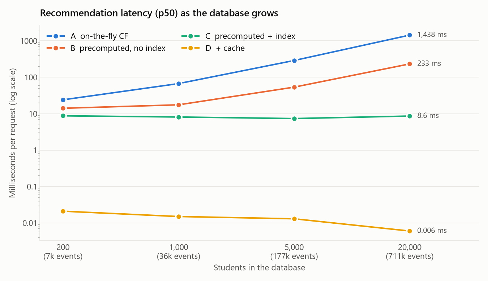
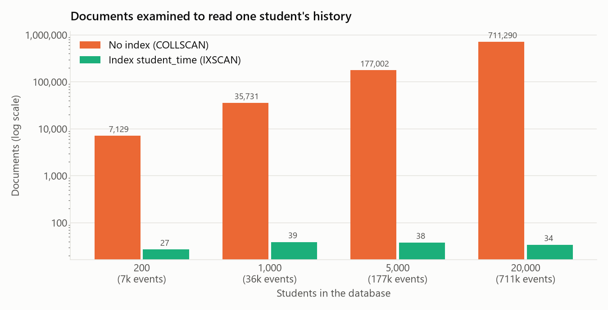
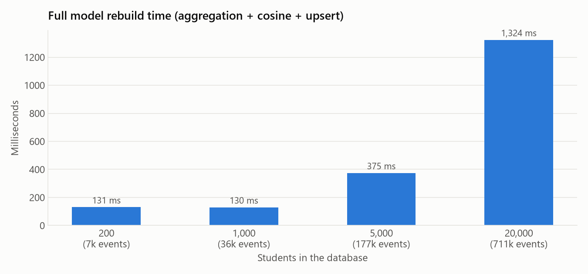
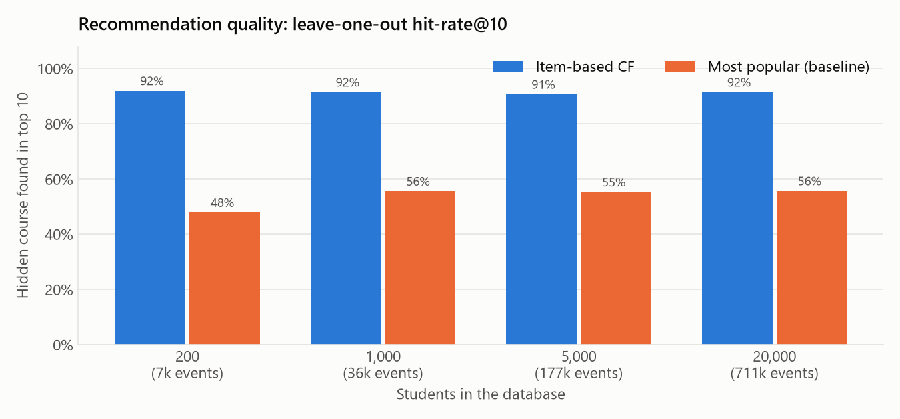

# Performance analysis and optimization report

## Setup

| | |
|---|---|
| Machine | Windows 11 PC. MongoDB 8 in Docker Desktop (WSL2) on the same host. JDK 21, `-Xmx2g` |
| Data | The synthetic seeder (fixed random seed): 40 courses; 200 / 1,000 / 5,000 / 20,000 students; 7k → 711k interactions |
| Method | `BenchmarkRunner` (`--app.bench.enabled=true`), separate database `edurec_bench`. For every size: reseed, rebuild the model, then time the same 100 random students (20 for the slow baseline A) after a 5-call JVM warm-up. Latencies are measured in-process (service call, no HTTP) |
| Raw data | `build/bench/results.csv` (copied below) |

Four ways of serving `GET /api/students/me/recommendations` are compared:

| Variant | What happens per request |
|---|---|
| **A** on-the-fly CF | Aggregate **all** interactions → build the whole item-item model → score. The naive implementation |
| **B** precomputed, no index | Read the student's history (`$match studentId`) **without** an index, then read the neighbour lists from `course_similarities` by `_id` |
| **C** precomputed + index | Same as B with the compound index `{studentId:1, occurredAt:-1}` |
| **D** + cache | Same as C, with the result served from the Spring cache (`@Cacheable("recs")`) |

## Results

### Latency (milliseconds per request)

| Students | Interactions | A p50 | A p95 | B p50 | B p95 | C p50 | C p95 | D p50 | D p95 |
|---:|---:|---:|---:|---:|---:|---:|---:|---:|---:|
| 200 | 7,129 | 24.0 | 30.9 | 14.1 | 19.1 | 8.7 | 10.9 | 0.021 | 0.034 |
| 1,000 | 35,731 | 67.0 | 77.2 | 17.5 | 23.4 | 8.1 | 9.9 | 0.015 | 0.026 |
| 5,000 | 177,002 | 288.7 | 329.0 | 53.5 | 59.9 | 7.4 | 8.7 | 0.013 | 0.019 |
| 20,000 | 711,290 | **1,437.8** | 1,821.5 | 232.7 | 400.9 | **8.6** | 10.2 | **0.006** | 0.006 |

- **A grows linearly with the data.** 100× more interactions makes it 60× slower. At 20k students one request takes about 1.4 s, which is unusable.
- **B removes the model computation but still grows.** Without an index, MongoDB scans the whole `interactions` collection to find one student's history.
- **C is flat at about 8 ms** from 7k to 711k interactions. The work per request depends only on the size of the student's own history (10–40 events) and on about 10 `_id` lookups. At 20k students it is **167× faster than A** and **27× faster than B**.
- **D** answers repeated requests from memory in a few microseconds, about 1,000× faster again.

### Index effect (`explain("executionStats")`)

| Students | Docs examined without index | Docs examined with index | Keys examined with index |
|---:|---:|---:|---:|
| 200 | 7,129 | 27 | 27 |
| 1,000 | 35,731 | 39 | 39 |
| 5,000 | 177,002 | 38 | 38 |
| 20,000 | 711,290 | 34 | 34 |

Without the index the plan is `COLLSCAN`, and every document in the collection is read. With the index the plan is `IXSCAN → FETCH`: the documents examined equal the documents returned, an ideal 1:1 ratio. At 20k students one query took 282 ms without the index and 0 ms with it (`docs/screenshots/14_explain.png`).

### Model rebuild cost

| Students | Interactions | Rebuild (ms) |
|---:|---:|---:|
| 200 | 7,129 | 131 |
| 1,000 | 35,731 | 130 |
| 5,000 | 177,002 | 375 |
| 20,000 | 711,290 | 1,324 |

The rebuild runs one `$group` aggregation, then the cosine computation in memory, then an upsert of one document per course. It is linear in the number of interactions and takes 1.3 s for 711k events. Running it every 10 minutes is therefore cheap, and the cost is paid once instead of on every request (compare with variant A).

### Recommendation quality (offline)

Leave-one-out: for every student with at least 3 courses, one enrolled course is hidden. The model is rebuilt without it, and we check whether the hidden course appears in the top 10.

| Students | Item-based CF hit-rate@10 | Most-popular hit-rate@10 |
|---:|---:|---:|
| 200 | 92.0 % | 48.0 % |
| 1,000 | 91.5 % | 55.7 % |
| 5,000 | 90.7 % | 55.4 % |
| 20,000 | 91.5 % | 55.8 % |

CF finds the hidden course about 1.65× more often than the popularity baseline. Note: the data is synthetic (students prefer categories linked to their faculty), and the catalog is small (40 courses, top 10 = 25 % of it). The absolute numbers are therefore optimistic. The comparison between the two methods is what matters.

## Optimizations applied

1. **Precomputed read model (`course_similarities`).** This is the main optimization. The expensive part of CF, the item-item similarities, moves from the request path to a background job. Each course stores its top-20 neighbours inside one document, a denormalized structure that is idiomatic for MongoDB. A request reads only the documents it needs, by `_id`, with no joins and no `$lookup`. Item-based (not user-based) CF was chosen because the number of courses is small and stable, while the number of students grows.
2. **Compound index `{studentId: 1, occurredAt: -1}` on `interactions`.** It serves both the history page (sorted by time) and the recommender's `$match`. It turns an O(N) scan into an O(history) index scan, as the explain table shows.
3. **Index `{stats.enrollCount: -1}` on `courses`.** The cold-start fallback (most popular courses) reads the top of the index instead of sorting the collection.
4. **Application cache (`@Cacheable`)**: `recs` per student and `similar` per course.
   - **Invalidation:** a new interaction evicts that student's entry (`@CacheEvict` in `InteractionService.record`), so the student immediately sees updated recommendations. A model rebuild clears both caches.
   - **Limitation:** the cache is a plain `ConcurrentMapCache`. It is unbounded and local to one instance. For production, use Caffeine (size and TTL limits) or Redis when running several instances.
5. **Denormalized counters.** `stats.enrollCount`, `ratingSum` and `ratingCount` are updated with `$inc` when an interaction is recorded (from Assignment #6). Popularity and average rating therefore never require an aggregation at read time.
6. **Bulk writes.** The seeder inserts all interactions with one `insertMany`, and the rebuild upserts with `saveAll`. Reseeding 20k students (711k events), including the cleanup, takes about 20 s.

## Scalability limits and next steps

- **Rebuild time** grows linearly with interactions. Past roughly 10M events, the next steps are an incremental update of the co-occurrence counts on each new interaction, or running the rebuild on a secondary node.
- **Pair count:** the number of course pairs grows with the square of the catalog size. Storing only the top-K neighbours (K = 20) keeps both the storage and the read cost per course constant.
- **Sharding:** if `interactions` outgrows one node, `studentId` is the natural shard key. The per-student history query is then served by a single shard.
